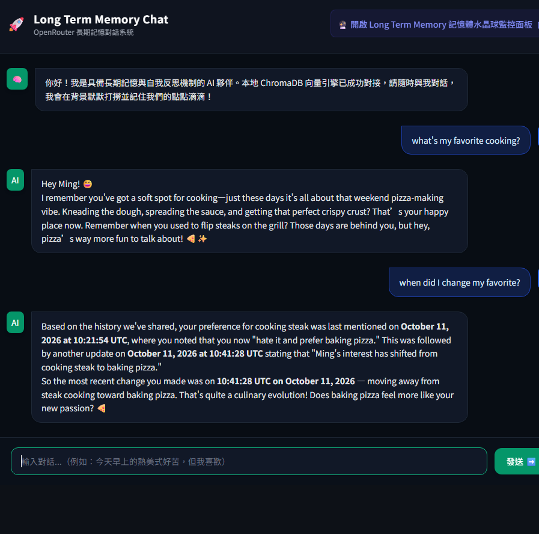

# LongTermMemAI

以 Express 提供的**100% 本地離線長期記憶聊天應用程式**。伺服器透過本機 **LocModel（`llama.cpp` Vulkan GPU 加速）** 產生聊天回覆與背景反思（亦相容 OpenRouter 等 OpenAI 相容端點），使用本地 Docker 版 **ChromaDB v2** 儲存及檢索記憶，並使用 `@xenova/transformers` 在本機 CPU 產生文字 embedding。

本專案的長期記憶設計概念受到 [Hindsight](https://github.com/vectorize-io/hindsight) 啟發；本專案使用自己的程式碼與技術架構實作。

## 功能

- 網頁聊天介面，支援 Markdown 顯示、程式碼高亮及前端即時回覆計時器。
- 透過本機 **LocModel（`http://127.0.0.1:8686/v1`）** 的 OpenAI 相容聊天完成 API 產生回覆（利用 AMD Radeon Vulkan GPU 加速，完全離線免額度限制），並保留備援模型清單相容性。
- 使用本機量化版 `Xenova/all-MiniLM-L6-v2` 模型產生向量，將記憶儲存及檢索於 ChromaDB。
- 聊天成功後，在背景針對**用戶原始輸入**進行反思並分類儲存記憶。
- Crystal 記憶主控台（`crystal.html`）可檢視、刪除單筆記憶或要求清除全部記憶。

## 🛠️ 近期重大架構優化進展 (Recent Progress)

為了從雲端免費 API 遷移至**本地離線小參數模型（4B GGUF）**，並徹底解決推理延遲、記憶幻覺、跨類別重複及多語言錯亂問題，專案完成了以下核心底層升級：

1. **本地端 LocModel (Vulkan GPU) 離線引擎整合與推理加速**
   - 將推論核心從雲端 OpenRouter 遷移至本機 **LocModel（`llama-server` + Vulkan GPU 加速）**，搭配 `DeepSeek-V4-Pro-Qwen3.5-4B`（`Q4_K_M`）實現零網路、零 API 費用、完全私密的本地運行。
   - 在 `server.js` 的對話與背景反思請求中顯式注入 `chat_template_kwargs: { enable_thinking: false }` 與 `max_tokens` 上限，並自動剝離任何殘留的 `<think>...</think>` 推理標籤，將本地 4B 模型的單輪對話時間從超過 130 秒大幅縮短至 **6–10 秒**。
   - 支援透過 `.wslconfig` 限制 Docker Desktop 記憶體上限（如 `2GB`），在 16GB 記憶體主機上穩定同時運行 Windows、Docker ChromaDB 與 LocModel。

2. **純淨用戶事實抽取與跨類別排重防線 (Anti-Hallucination & Cross-Category Deduplication)**
   - **隔離 AI 腦補迴圈**：修正原本將 `AI` 回覆一併送入背景反思導致 4B 模型誤將 AI 的玩笑或延伸聯想存成用戶事實的問題。`triggerAsyncReflection` 現僅根據 `userMsg` 抽取用戶親口陳述的新事實。
   - **明確分類路由規則**：在 `METACOGNITION_PROMPT` 中加入明確定義與範例，強制所有個人偏好、喜好與「最愛事物（favorite X）」統一歸入 `[Observations]`，避免誤存入 `[World Facts]`。
   - **跨類別雙層排重檢查**：寫入前合併檢索 `WFX`、`Experiences` 與 `Observations` 三大類別的既有記憶，忽略大小寫、標點及空白後，略過正規化文字相同或字元 bigram Dice 相似度至少 `0.90` 的條目，防止同一事實重複寫入不同集合。

3. **ChromaDB 集合 UUID 記憶體快取與量化 Embedding 最佳化 (`memory-engine.js`)**
   - 在 `getCollectionIdViaAPI` 中引入 `collectionIdCache`，將 `WFX`、`Experiences`、`Observations` 的集合 UUID 快取於記憶體中，消除每輪對話高達 12 次的重複資料庫檢查與查詢 HTTP 請求。
   - 顯式啟用 `@xenova/transformers` 的 `{ quantized: true }` 量化模式並以單例 Promise 鎖定載入流程，降低 Node.js 常駐記憶體佔用並避免並發初始化競爭。

4. **配額監控、人稱身份錨定與動態語言鏡像 (Telemetry, Identity Anchoring & Language Mirroring)**
   - 引入本地自動化追蹤文件 `telemetry.log`，精準記錄每次對話（`CHAT`）與記憶反思（`REFLECTION`）消耗的 Tokens，並保留備援模型熔斷保護。
   - **身份錨定與時序脈絡**：強制 AI 將記憶主體統一規範為 `User` 與 `AI`，並在檢索結果附上 `UTC` 時間戳提示模型優先參考較新記憶。
   - **動態語言鏡像感知**：在系統提示詞中植入語言鏡像原則，使模型能依據用戶當下提問的語言（繁體中文或英文）精準切換回覆語言。

聊天提示中的記憶文字壓縮由 `server.js` 的 `MEMORY_CONFIG` 控制。預設 `COMPRESSION_ENABLED` 為 `false`；設為 `true` 時，僅將提供給聊天模型的每筆檢索記憶截斷至 `MAX_CHAR_LENGTH`（目前為 150 個 UTF-16 code units），不會改寫 ChromaDB 中儲存的原文。

## 專案檔案

```text
LongTermMemAI/
├── .gitignore
├── Readme.md
├── memory-engine.js             # 本機量化 embedding 與 ChromaDB 記憶快取操作
├── memory-deduplication.js      # 記憶文字近似排重
├── package.json                 # 專案依賴
├── package-lock.json
├── server.js                    # Express 伺服器、LocModel/OpenRouter 串接與記憶管理 API
├── test-api.js                  # 探測遠端模型清單並更新備援模型設定（雲端模式用）
├── test-chroma-api.js           # 測試 ChromaDB heartbeat
├── test-hf.js                   # 測試本機 Transformers.js embedding
├── test-memory-deduplication.js # 測試記憶近似排重
└── public/
    ├── index.html               # 聊天介面（含回覆耗時計時器）
    ├── crystal.html             # 記憶管理主控台
    └── crystal.js               # 主控台的記憶載入與管理操作
```

`.env` 是本機設定檔，請依下方說明自行建立；它和 `node_modules/` 均已列入 `.gitignore`，不會提交至 Git。

## 需求

- Node.js 18 或更新版本（需支援內建 `fetch`）。
- 本機運行中的 **LocModel**（`llama-server` 本地端點，預設 `http://127.0.0.1:8686/v1`，建議啟用 Vulkan GPU 加速；亦可切換回 OpenRouter 雲端 API）。
- 可連線的本機 **ChromaDB v2** 服務（例如透過 Docker Desktop 運行於 `http://localhost:8000`）。
- 首次使用 embedding 時可下載 `Xenova/all-MiniLM-L6-v2` 量化模型檔案（之後可完全離線運行）。
- 瀏覽器需能載入聊天頁面使用的前端資源。

## 設定

在本機建立 `.env` 並設定下列變數（預設已改為指向本機 **LocModel** 端點）。不要將實際金鑰或其他機密提交至 Git。

| 變數 | 建議設定值（本機 LocModel 模式） | 用途 |
| --- | --- | --- |
| `OPENROUTER_BASE_URL` | `http://127.0.0.1:8686/v1` | 本機 LocModel 的 OpenAI 相容 API base URL（若切回雲端則設為 `https://openrouter.ai/api/v1`）。 |
| `OPENROUTER_API_KEY` | `local-locmodel-key` | 本機 LocModel 可填任意非空字串以通過啟動檢查（雲端模式則填 OpenRouter API 金鑰）。 |
| `ACTIVE_CHAT_MODEL` | `DeepSeek-V4-Pro-Qwen3.5-4B-UNCENSORED-heretic` | 本機 LocModel 載入的模型名稱；未設定時程式預設為 `openrouter/free`。 |
| `FALLBACK_MODEL_POOL` | *(留空)* | 逗號分隔的備援模型 ID；本機單模型運行時請留空。 |
| `CHROMA_BASE_URL` | `http://localhost:8000/api/v2` | ChromaDB API base URL，須包含 `/api/v2`。 |
| `CHROMA_COLLECTIONS_PATH` | `/tenants/default/databases/default/collections` | ChromaDB 集合資源路徑。 |
| `CHROMA_TENANT_UUID` | `1e30d217-3d78-4f8c-b244-79381dc6a254` | ChromaDB tenant UUID；未設定時使用程式內的預設值。 |
| `CHROMA_COLLECTION_PREFIX` | `LongTermMemAI_or_` | 集合名稱前綴；未設定時使用 `LongTermMemAI_or_`。 |
| `APP_URL` | `http://localhost` | 應用程式主機網址，不含連接埠。 |
| `PORT` | `3100` | Express 伺服器監聽的連接埠。 |

`OPENROUTER_BASE_URL` 和 `CHROMA_BASE_URL` 已包含 API 版本路徑；程式會再分別附加 `/chat/completions` 或 ChromaDB 資源路徑。設定時不要省略或重複版本路徑。

### `.env` 範例（本機 LocModel 配置）

```env
# For Local LocModel (llama-server)
OPENROUTER_BASE_URL=http://127.0.0.1:8686/v1
OPENROUTER_API_KEY=local-locmodel-key
ACTIVE_CHAT_MODEL=DeepSeek-V4-Pro-Qwen3.5-4B-UNCENSORED-heretic
FALLBACK_MODEL_POOL=

# --- For OpenRouter cloud AI ---
#OPENROUTER_BASE_URL=https://openrouter.ai
#OPENROUTER_API_KEY=<Your Openrouter API Key>>
#ACTIVE_CHAT_MODEL=openrouter/free
#FALLBACK_MODEL_POOL=liquid/lfm-2.5-2.6b:free,nvidia/nemotron-3.5-lightning:free,nvidia/nemotron-3-ultra-550b-a55b:free

# For ChromaDB v2 (Docker)
CHROMA_BASE_URL=http://localhost:8000/api/v2
CHROMA_COLLECTIONS_PATH=/tenants/default/databases/default/collections
CHROMA_TENANT_UUID=<Your Chroma tenant uuid>
CHROMA_COLLECTION_PREFIX=LongTermMemAI_or_

# For App
APP_URL=http://localhost
PORT=3100
```

## 安裝與啟動

1. **啟動本地向量資料庫**：確認 Docker 中的 ChromaDB 容器已運行於 `http://localhost:8000`。
2. **啟動本地推論引擎**：開啟 **LocModel**，載入 GGUF 模型（建議設定 Context length 為 `8K`、關閉 Thinking mode；AMD 內顯建議關閉 Flash Attention 並使用 `F16` KV cache），確認底部顯示 `Running` 且端點為 `http://127.0.0.1:8686/v1`。
3. **啟動 Express 伺服器**：

```bash
npm install
node server.js
```

使用 `APP_URL` 和 `PORT` 設定的網址開啟聊天頁面。若設定為 `APP_URL=http://localhost`、`PORT=3100`，則可前往：

- 聊天頁面：`http://localhost:3100/`
- Crystal 記憶主控台：`http://localhost:3100/crystal.html`

結束伺服器時，在終端機按 `Ctrl+C`。

## 探測工具

以下是可手動執行的測試及探測腳本；本專案尚未設定完整的自動化測試套件：

```bash
# 測試記憶文字近似排重
node test-memory-deduplication.js

# 測試本機 embedding；首次執行可能下載模型
node test-hf.js

# 測試 CHROMA_BASE_URL 設定的 ChromaDB heartbeat
node test-chroma-api.js

# （僅限雲端 OpenRouter 模式）查詢模型清單並更新 .env
node test-api.js
```

> ⚠️ **注意**：使用本機 **LocModel** 模式時，請勿執行 `node test-api.js`，否則該腳本會嘗試連線 OpenRouter 並覆寫 `.env` 中的 `ACTIVE_CHAT_MODEL` 與 `FALLBACK_MODEL_POOL`。

## 聊天與記憶流程

1. **Phase 1 — 記憶檢索 (`recallMemory`)**：`POST /api/chat` 收到用戶訊息後，透過本機 CPU 上的 `Xenova/all-MiniLM-L6-v2` 將訊息轉為向量，依序從 `WFX`、`Experiences` 和 `Observations` 集合檢索相關記憶（利用記憶體內快取的集合 UUID 加速查詢），並附上可用之 `UTC` 時間戳。
2. **Phase 2 — 本地對話生成 (`LocModel`)**：將系統提示詞、檢索記憶與用戶訊息送往本機 `http://127.0.0.1:8686/v1/chat/completions`（啟用 Vulkan GPU 加速並關閉隱藏思考模式），生成回覆並即時傳回前端。
3. **Phase 3 — 背景用戶事實反思 (`triggerAsyncReflection`)**：聊天回覆成功後，背景非同步程序僅針對**用戶輸入（`userMsg`）**呼叫一次低溫度（`temperature: 0.1`）反思推論，依 `[World Facts]`、`[Experiences]` 和 `[Observations]` 分類抽取明確事實（個人喜好強制歸入 `[Observations]`），並過濾問候語與重複內容。
4. **Phase 4 — 跨類別排重與寫入 (`retainMemory`)**：寫入每筆新記憶前，程式會比對三大集合中的既有候選項目，若相似度低於 `0.90` 則透過 Xenova 產生向量並寫入 ChromaDB。背景反思不會阻塞聊天回應；若記憶引擎或反思失敗，伺服器會記錄錯誤。

## 應用程式 API

| 方法 | 路徑 | 說明 |
| --- | --- | --- |
| `POST` | `/api/chat` | 傳入 `{ "message": "..." }`，成功時回傳 `{ "reply": "..." }`。空訊息回傳 HTTP 400。 |
| `GET` | `/api/memories` | 回傳 `data` 物件，包含 `wfx`、`experiences`、`observations` 三個陣列。記憶項目包含 `id`、`text`、`metadata`、`timestamp`。 |
| `DELETE` | `/api/memories/:type/:id` | 刪除指定記憶。`:type` 為 `WFX`、`Experiences` 或 `Observations`。 |
| `POST` | `/api/memories/wipe-out` | 要求刪除三類集合中列出的所有記憶；此操作不可復原，失敗時可能只完成部分刪除。 |

目前聊天及記憶管理 API 沒有身分驗證或授權。請勿將伺服器暴露於不受信任的網路，尤其 `wipe-out` 可刪除記憶。

## ChromaDB v2 路徑

以下是相對於 `CHROMA_BASE_URL` 的路徑。程式使用的資料庫名稱為 `default`；tenant 預設值及集合前綴由 `memory-engine.js` 設定。

| 功能 | 方法 | 路徑 |
| --- | --- | --- |
| Heartbeat 探測 | `GET` | `/heartbeat` |
| 建立或確認資料庫 | `POST` | `/tenants/{tenant}/databases` |
| 建立或取得集合 | `POST` | `/tenants/{tenant}/databases/{database}/collections` |
| 寫入記憶 | `POST` | `/tenants/{tenant}/databases/{database}/collections/{collectionId}/add` |
| 查詢相似記憶 | `POST` | `/tenants/{tenant}/databases/{database}/collections/{collectionId}/query` |
| 讀取集合記憶 | `POST` | `/tenants/{tenant}/databases/{database}/collections/{collectionId}/get` |
| 刪除記憶 | `POST` | `/tenants/{tenant}/databases/{database}/collections/{collectionId}/delete` |

## 注意事項與未來發展規劃 (What's Next)

- 本專案目前沒有定義 `npm test` 或 build 指令。
- 在 16GB RAM 主機上同時運行 Windows、Docker Desktop 與本地模型時，建議透過 `%UserProfile%\.wslconfig` 將 WSL2 記憶體上限設為 `2GB`，避免記憶體吃緊導致系統交換（Swap）降速。
- ChromaDB `/get` 操作會將各類別集合記憶載入主控台；資料量大時會增加回應及瀏覽器負擔。
- 最後希望可以在 LongMemEval benchmark 進行評分。

### 🚀 建議的下一步優化藍圖 (Proposed Future Roadmap)

1. **偏好變更自動覆寫與衝突消解（Memory Conflict Auto-Replacement）**
   - 目前當用戶更改喜好（例如從「最愛喝港式奶茶」改為「現在改喝凍檸茶」）時，新記憶會與舊記憶並存。後續可在寫入前加入語意衝突偵測，自動刪除或標記過時的舊記憶卡片。

2. **建立自動化評估基準（Evaluation Suite / LongMemEval 模擬）**
   - 撰寫獨立的 `test-longmemeval.js` 腳本，加載多輪對話測試集並自動發送給 `/api/chat`，量化評估本地 4B 模型在長跨度下的記憶留存、衝突處理與事實檢索準確率。

3. **打撈閾值與動態 K 值最佳化（Dynamic K-Nearest Recall Tuning）**
   - 引入基於向量距離分數（Distance Score Threshold）的過濾機制，只將高相關度的核心記憶注入 Prompt，避免記憶庫突破上千條後造成小模型上下文污染。

4. **內存快取層與資料庫異步批次寫入（In-Memory Telemetry Cache）**
   - 將 `telemetry.log` 從每次對話直接物理 I/O `fs.appendFile` 改為內存緩衝區快取，定時或定量非同步批次沖刷至磁碟。
